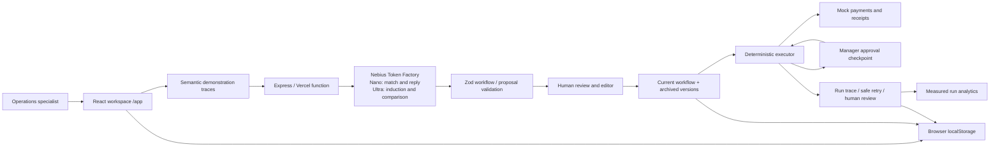

# ShadowOps demo package

Prepared on 2026-10-05. Live provider/engine acceptance passed with Nebius Nano/Ultra; [evidence](evidence/live-acceptance.json) contains actual workflow, comparison, match, execution trace and mock receipts. Payment and message effects are local mocks; no real refund or external email occurred.

## Recorded browser demo

[Watch the 2m33s recording](../public/demo/shadowops-demo.mp4). It uses live Nemotron and mock payments/messages, with cuts and 2× speed labeled throughout; there is no audio. It includes the observed reply failure and successful checkpoint retry using the same receipt. [Browser evidence](evidence/browser-acceptance.json) confirms one Daniel confirmation, one refund trace and Sarah’s untouched payments.

## Architecture

The server owns prompts, policy context and model credentials. The browser owns demo ledger/history; database persistence is deliberately deferred. Runtime refund guards remain authoritative even if an edited rule is weaker. A failed communication step can resume with its existing receipt, while an ambiguous financial effect requires human review.

## Three-minute presentation script

- **0:00–0:20 — Problem and scope.** Open the landing: specialists repeatedly resolve the same support tasks, but an approval exception still requires judgment. Explain that this demo uses live AI and mock business effects.
- **0:20–1:05 — Observe Maria.** Enable Teach Mode, inspect customer/payments, verify duplicate, check policy, refund, save reply and close. Stop & Learn. Show live provider/model, review the sequence, then save v1.
- **1:05–1:40 — Learn Alex's exception.** Demonstrate the high-value case, request manager approval and approve before refund. Complete reply/closure. Review Nemotron's conditional proposal and accept v2. Show archived v1 and source demonstrations.
- **1:40–2:15 — Execute Daniel.** Show live matching, start the workflow, and inspect skipped approval, actual receipt, saved confirmation and resolved ticket.
- **2:15–2:40 — Safe stop and visibility.** Run Sarah: no duplicate, no refund, failed trace retained. Assign human review. Show measured analytics and real date filtering.
- **2:40–3:00 — Architecture and limits.** Nemotron proposes; humans review; validated deterministic tools execute. State browser-local persistence, mock transactions, no production authentication and future shared database work.

Use cuts to remove waiting time for model responses, label accelerated/cut footage, and retain visible live provenance. Do not present offline fixture output as learned AI. The acceptance JSON is independent evidence, rather than a substitute for a browser demonstration.

## Deployment and handoff

This machine cannot log into Vercel; no public deployment is claimed. Follow [the deployment procedure](DEPLOYMENT.md) on another machine. Use `python3 scripts/package-source.py` to export source without credentials. The included MIT license is the stated default; change it before public distribution if the owner selects another license.
